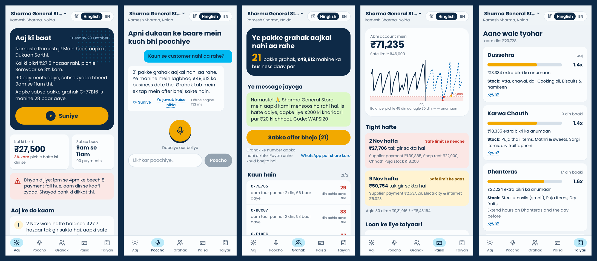

# Dukaan Sarthi

**Aapki dukaan, aapka Sarthi.** A voice-first AI business copilot for Paytm merchants.
Built for the Paytm AI Hackathon, Track 1: Merchant Growth AI.

Small shopkeepers hear “₹50 received” dozens of times a day, but nobody tells them their Tuesday regulars stopped coming, that the week of Diwali stock and rent will run their account dry, or that a settlement came in ₹160 short. Dukaan Sarthi turns their Paytm transaction data into a business partner that speaks Hindi, Hinglish or English, through the app and the Soundbox.



## Run it (one command)

Needs Python 3.10+. The UI is prebuilt in `frontend/dist`, so Node is not needed to run the demo.

```bash
./run.sh          # macOS / Linux
run.bat           # Windows
```

Then open **http://localhost:8000** (use Chrome on a phone or desktop for voice input) and **http://localhost:8000/metrics** for the measured results.

`run.sh` installs the requirements, generates the synthetic data (`python -m backend.seed`), computes the metrics (`python -m backend.metrics`) and starts the server.

**Optional: Claude for open-ended questions.** Copy `.env.example` to `.env` and set `ANTHROPIC_API_KEY`. Without a key, Ask Anything uses the built-in offline engine, which handles the common questions in all three languages. If the API is slow or unreachable, the app falls back to that engine automatically.

**Docker:** `docker build -t dukaan-sarthi . && docker run -p 8000:8000 dukaan-sarthi`

## What it does

| Feature | Where | How |
|---|---|---|
| **Daily Business Brief** | Aaj tab | A spoken summary of yesterday's sales vs the same day last week, peak hours, top customer, anomalies (e.g. a failed-payment spike), plus the 2 most important actions for today, ranked. Every action has a “Kyun?” (why). |
| **Ask Anything** | Poocho tab | Voice or text in Hindi, Hinglish or English. Claude calls tools, including guarded text-to-SQL. The offline intent router answers when there's no key. The SQL behind each answer is shown. |
| **Customer Win-back** | Grahak tab | RFM + k-means segments. A regular is flagged as lapsing when their silence is over 4x their own usual gap. Sends a ready offer in the merchant's language in one tap. |
| **Cash-flow & Credit** | Paisa tab | 30-day balance forecast (settlements in, rent, salary, supplier, festival stock out), red/amber low-cash weeks, and a credit-readiness score with plain reasons and an indicative limit. |
| **Festival & Demand Planner** | Taiyari tab | Upcoming festivals with the expected sales multiplier, calibrated on how this shop did on past festivals, plus stock and staffing tips. |
| **Reconciliation & Disputes** | Taiyari tab | Matches every settlement to the day's sales, explains refunds and delays, finds the exact missing payment, and drafts the dispute. |
| **Soundbox Nudges** | Aaj tab | Simulate a payment: chime, “₹120 prapt hue”, and milestones like “Aaj ki 50th sale! Kal isi time se 8% zyada.” |

## Measured on the synthetic pilot

Five merchant personas (kirana, salon, chai shop, pharmacy, sweet shop), about 6 months, about 83,000 payments. Each feature is scored against hidden ground truth or by backtesting. Numbers are from `python -m backend.metrics` (also at `/metrics`). These are simulation results, not field data.

| What | Result |
|---|---|
| Lapsing regulars found | 53 of 64 (83% recall, 66% precision) |
| Settlements needing a manual check | 4% (873 of 910 auto-resolved); 32 of 32 injected shortfalls caught |
| Low-cash weeks warned 8–14 days ahead | 3 of 4, with 7 false alarms in 71 normal weeks |
| 30-day sales forecast error (WAPE) | 19% vs 25% for a same-weekday average (24% better) |
| Ask Anything (offline engine) | 33 of 33 test questions routed correctly; p95 137 ms |
| Raw customer IDs stored | 0 (payer IDs hashed at ingestion) |

## Repo layout

```
backend/
  main.py            FastAPI app: /api/* plus the PWA
  seed.py            synthetic data generator (5 personas, ground truth in _truth_* tables)
  sqlguard.py        read-only, merchant-scoped SQL for the LLM
  llm.py             minimal Claude Messages API client (stdlib only)
  i18n.py            Hinglish / Hindi / English templates, ₹ formatting
  metrics.py         evaluation behind /metrics
  calendar_data.py   2026 festival calendar + category priors
  features/          brief, ask, winback, cashflow, festival, recon, nudges
frontend/            React + Tailwind PWA (src/), prebuilt to dist/
tests/test_core.py   12 tests (python -m pytest -q)
docs/                architecture, demo script, screenshots
```

To change the UI: `cd frontend && npm install && npm run build` (or `npm run dev` to rebuild on save).

## Notes and limits

- All data is synthetic. Festival dates are real 2026 dates, and the category uplift priors are assumptions.
- The demo runs on a fixed date (20 Oct 2026, Dussehra) so the story is the same every time. Change it with `DEMO_TODAY`.
- The credit score and limit are indicative only. A real lending decision belongs to Paytm's lending partner.
- Voice input uses the browser's Web Speech API (best in Chrome). Voice output uses the browser's Hindi/English voices.
- Poppins font © Indian Type Foundry, SIL Open Font License 1.1, self-hosted so the app works offline.

See [docs/architecture.md](docs/architecture.md) for the flow, privacy and scaling design.
