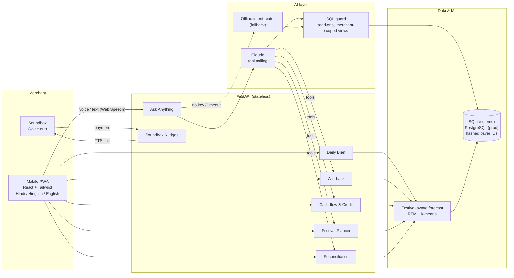

# Architecture

## How a question flows

1. The merchant taps the mic and asks *“Pichle hafte kitna kamaya?”*. The browser's Web Speech API (hi-IN) turns it into text.
2. `POST /api/ask` sends it to Claude with six tools: `run_sql` plus the win-back, cash-flow, festival, credit and reconciliation features.
3. `run_sql` goes through `sqlguard.py`:
   - read-only connection
   - a single SELECT only
   - an SQLite authorizer that allows reads only through per-merchant temp views (`my_payments`, …)
   - a row cap and a 2-second timeout

   A merchant can never read another merchant's rows or the evaluation tables.
4. Claude replies in the chosen language in at most 3 sentences. The UI reads it aloud and shows the SQL under “How this was worked out”.
5. With no API key, or if the API is slow or unreachable, the offline intent router answers the same question from SQL templates. The demo never breaks.

## Privacy

- Payer VPAs are hashed at ingestion into `C-xxxxx`. No names, phone numbers or VPAs are stored.
- The LLM only sees aggregates and pseudonymous IDs, never raw PII.
- Win-back offers are queued for Paytm to deliver on its own channel, so the merchant never sees customers' numbers.

## Scaling to millions of merchants

- The API is stateless, so it scales horizontally behind a load balancer.
- Daily briefs are precomputed by async jobs between 5 and 7 am and cached. Each merchant's brief is a few small SQL aggregates.
- Production runs PostgreSQL with `merchant_id` partitioning. Per-merchant views become row-level security policies.
- Every feature except open-ended Ask Anything is plain SQL plus light ML, with no LLM in the loop. LLM cost applies only when a merchant asks a question.
- Category festival priors are learned across all merchants in a category, so every new merchant gets a good forecast on day one.

## Plugging into Paytm

| Demo | Production |
|---|---|
| `backend/seed.py` synthetic data | Paytm merchant transaction, settlement and refund APIs / data lake |
| Browser TTS | Soundbox voice channel (the same device that says “₹50 received”) |
| `campaigns` table, status `queued` | Paytm's customer messaging (push / SMS / WhatsApp) to hashed payer IDs |
| Indicative credit limit | Paytm lending partners' underwriting, with this score as a feature |
| Dispute draft | Paytm for Business support ticket API |
